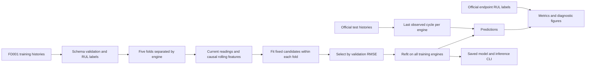
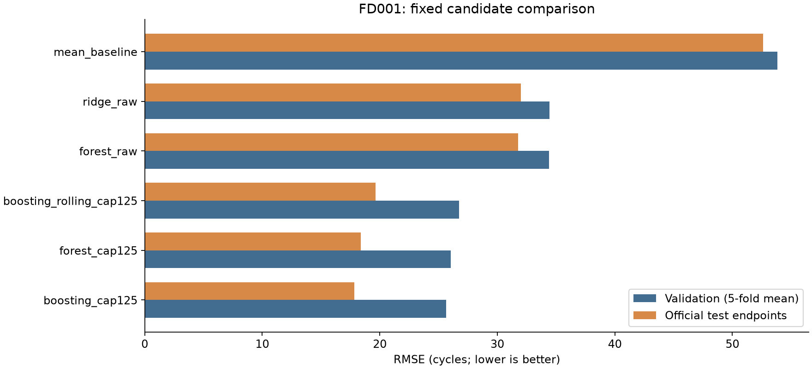
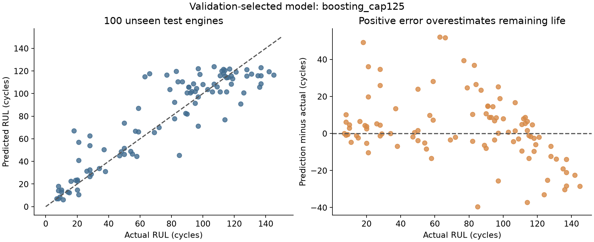

# Aircraft Engine Remaining Useful Life Prediction

**Predictive maintenance with NASA C-MAPSS FD001 sensor histories.**

This project estimates how many operating cycles remain before a simulated turbofan engine fails. It brings together an exploratory notebook, modular Python source, model comparisons, and saved prediction reports, with validation organized by engine.

**Recorded result:** The validation-selected gradient-boosting model achieves **17.83-cycle RMSE**, **12.70-cycle MAE**, and **0.816 R²** on the 100 official FD001 test endpoints.

[Original notebook](notebook/aircraft-predictive-maintenance.ipynb) · [Technical presentation](docs/aircraft-predictive-maintenance.pptx) · [Data documentation](data/README.md) · [Saved metrics](reports/metrics.csv)

## What this project demonstrates

- Framing run-to-failure histories as a supervised regression problem.
- Preventing engine overlap between training and validation, with preprocessing fit inside folds.
- Comparing simple baselines with nonlinear models and controlled feature/target experiments.
- Building causal time-series features and checking for future-data leakage.
- Organizing the work into Python modules, a CLI, tests, pinned dependencies, and saved reports.
- Reporting limitations and unsuccessful experiments alongside the selected result.

## Problem and data

The input contains three operating settings and 21 sensor readings per engine cycle. The output is remaining useful life in **cycles**, not hours or calendar time. Training histories continue to failure; the official test histories end early.

The study uses **FD001**, a simulated benchmark with one operating condition and one degradation mode. See the [data documentation](data/README.md) for the file schema, source attribution, and acquisition details.

| Partition | Engines | Rows | Labels |
|---|---:|---:|---|
| Training | 100 | 20,631 | Last cycle minus current cycle |
| Test | 100 | 13,096 | One supplied RUL label per engine endpoint |

## Project workflow



## Recorded results

Model selection uses five engine-separated folds and one deterministic pseudo-censored endpoint per held-out training engine. Test metrics use **uncapped** ground truth. Capped candidates use `min(RUL, 125)` only during training.

| Model | Validation RMSE, mean ± SD | Test RMSE | Test MAE | Test R² |
|---|---:|---:|---:|---:|
| **Gradient boosting, cap 125 — selected** | **25.63 ± 4.09** | **17.83** | **12.70** | **0.816** |
| Random forest, cap 125 | 26.04 ± 3.36 | 18.40 | 13.36 | 0.804 |
| Gradient boosting, rolling means, cap 125 | 26.75 ± 4.34 | 19.64 | 14.52 | 0.777 |
| Random forest, raw targets | 34.41 ± 5.60 | 31.77 | 23.57 | 0.416 |
| Ridge, raw targets | 34.43 ± 3.39 | 31.99 | 25.47 | 0.408 |
| Training-mean baseline | 53.82 ± 3.17 | 52.63 | 40.88 | −0.604 |



The random-forest target-cap comparison improves both validation and test RMSE with the same estimator settings. Adding rolling means to the boosting model does **not** improve this run, so the simpler instantaneous-input model is retained. These conclusions concern this fixed experiment, not all possible hyperparameters or operating regimes.

Validation and test scores reflect different censoring distributions and should not be treated as interchangeable estimates.

### Prediction diagnostics



The diagnostics show remaining errors, including overestimates at some short lifetimes and underestimates above the training cap. The selected model's asymmetric error score is **906.46**, summed across 100 test engines. Positive errors overestimate remaining life and receive the stronger penalty.

The saved reports include [model metrics](reports/metrics.csv), [validation-fold results](reports/validation_folds.csv), and [test predictions](reports/test_predictions.csv).

## Repository guide

```text
src/aircraft_rul/   Data handling, features, metrics, experiments, and CLI
tests/              Existing data and experiment contract tests
data/               Dataset documentation and supplied FD001 files
notebook/           Original exploratory notebook with saved outputs
docs/               Technical presentation
reports/            Recorded metrics, predictions, and figures
requirements.txt    Pinned Python dependencies
```

## Limits and extensions

The results concern the supplied simulated FD001 benchmark. A single seed and fixed candidate set do not establish statistical superiority or performance on other operating regimes. Useful extensions include multi-seed validation, FD002–FD004 generalization, and calibrated prediction intervals.
